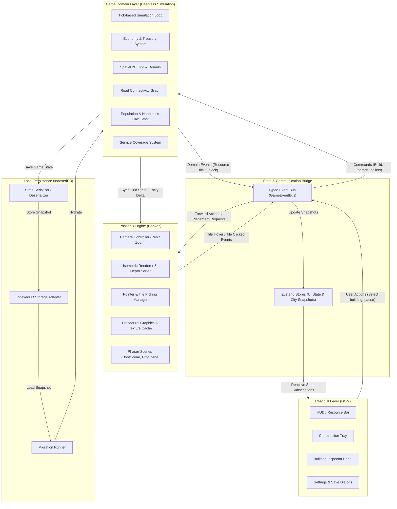
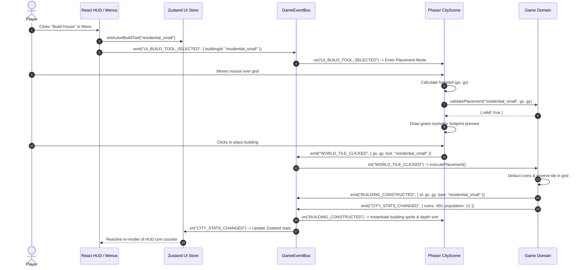

# Pixelopolis — System Architecture Specification

> **Document Status:** Confirmed Baseline (Phase 0)  
> **Author:** Game Development Technical Lead & Software Architect  
> **Target Platform:** Desktop Web Browsers (Chrome, Firefox, Safari, Edge)

---

## 1. High-Level System Architecture

Pixelopolis is engineered around an **unidirectional, decoupled, multi-tier architecture** designed to cleanly separate presentation, user interface, business/simulation logic, and data storage. 

Browser games often suffer from tight coupling where game engine objects (such as Phaser sprites) directly manage economic state or interact with DOM elements. Pixelopolis prevents this by establishing strict boundaries:



---

## 2. Module Responsibilities & Directory Mapping

The application codebase is organized into distinct functional modules:

### 2.1 React UI Layer (`src/components/`, `src/app/`)
- **Responsibilities:**
  - Renders all DOM-based user interface components above the game canvas.
  - Displays persistent HUD elements: current coin treasury, population counter, resource storage gauges, and city level.
  - Provides construction menus categorized by building type (Residential, Commercial, Industrial, Infrastructure, Public Services, Special).
  - Provides building inspection dialogs for upgrading, checking service coverage, and demolition.
  - Manages modal dialogs for settings, audio toggles, save/load management, and mission tracking.
- **Constraints:**
  - Must never import Phaser, game scenes, or Phaser game objects.
  - Must interact with the game solely via `GameEventBus` commands or by reading reactive Zustand stores.

### 2.2 State Bridge Layer (`src/store/`, `src/game/events/`)
- **Responsibilities:**
  - **Zustand Stores (`src/store/`):** Maintain fast, reactive UI state (e.g., active build tool, selected tile coordinates, modal visibility) and read-only snapshots of simulation metrics (coins, population, happiness, inventory).
  - **Typed Event Bus (`src/game/events/`):** Facilitates decoupled pub/sub messaging across Phaser, the simulation domain, and React.
- **Constraints:**
  - Zustand stores must not execute continuous simulation loops or store raw Phaser sprite instances.

### 2.3 Game Engine Presentation Layer (`src/game/`)
- **Responsibilities:**
  - Canvas initialization, WebGL/Canvas rendering, resolution scaling.
  - Scene lifecycle management (`BootScene`, `CityScene`).
  - Isometric camera controls (smooth drag-pan, mouse-wheel zoom, boundaries clamp).
  - Screen-to-grid raycasting and pointer picking.
  - Rendering isometric terrain tiles, road networks, and multi-tile building sprites.
  - Depth sorting (Z-indexing) to guarantee correct isometric occlusion.
  - Procedural texture generation and texture memory caching.
- **Constraints:**
  - Does not contain simulation business rules (e.g., how taxes are calculated or happiness decay formulas). It receives visual state updates from the domain layer and renders them.

### 2.4 Game Domain Simulation Layer (`src/domain/` or `src/game/systems/domain`)
- **Responsibilities:**
  - Headless, pure TypeScript simulation logic.
  - Spatial grid representation (2D matrix of tile data).
  - Building footprint validation (bounds check, obstacle check, road adjacency verification).
  - Economy management: coin accumulation, resource extraction, consumption recipes.
  - Population dynamics: capacity, citizen satisfaction calculation, workforce distribution.
  - Road connectivity graph: breadth-first search (BFS) or flood fill to verify connection to the city hub.
  - Service coverage calculation: radial or distance-decay service distribution (power, water, fire, police, health).
- **Constraints:**
  - 100% headless. Zero dependencies on DOM, React, or Phaser. Can be executed and unit-tested in Node.js or Vitest without a browser canvas.

### 2.5 Data Layer (`src/data/`)
- **Responsibilities:**
  - Pure declarative data structures defining game balancing and attributes.
  - Building definitions (footprints, costs, production cycles, unlock levels, upgrade paths).
  - Resource definitions (names, categories, base values, storage parameters).
  - Terrain definitions (tile types, buildability flags, movement costs).
  - Progression tables (XP thresholds, milestone rewards).

### 2.6 Local Persistence Layer (`src/persistence/`)
- **Responsibilities:**
  - Interfacing with browser IndexedDB using a typed wrapper.
  - Multi-slot save management (Slot 1, Slot 2, Slot 3, AutoSave).
  - Serialization of the simulation grid, building states, and player inventory into compact JSON.
  - Schema versioning and migration pipeline to upgrade legacy save files smoothly.

---

## 3. React and Phaser Communication

The interaction between React and Phaser is mediated through an **Event-Driven Bridge Pattern**:



### Communication Rules
1. **No Direct References:** React components must never hold a reference to `scene` or `game` objects.
2. **Event Payload Typing:** All events emitted over `GameEventBus` are strictly typed via TypeScript discriminated unions.
3. **Decoupled Lifecycle:** Phaser boots inside a dedicated container element (`<div id="phaser-container" />`) managed by `GameLayout.tsx`. If React re-renders, the Phaser instance is preserved without re-mounting.

---

## 4. Game-Domain Architecture (Headless Simulation)

The game domain is designed as a **deterministic, tick-based headless simulation**:

```
Simulation Tick (e.g., every 1.0s or configurable interval)
  │
  ├── 1. Service Propagation: Update power, water, and emergency service grids
  ├── 2. Production Tick: Progress timers on factories; produce output goods
  ├── 3. Economic Tick: Compute commercial tax revenue; deduct maintenance costs
  ├── 4. Population Dynamics: Calculate citizen happiness and housing occupancy
  └── 5. State Snapshot: Publish updated metrics to GameEventBus
```

### Determinism & Pure Functions
- All simulation calculations (e.g., `calculateHappiness(services, pollution)`) are pure functions.
- Random events or procedural variations utilize a seeded pseudo-random number generator (PRNG, e.g., Mulberry32 or splitmix32) so that simulation runs are reproducible for regression testing.
- The domain layer can run in a headless test runner without mocking WebGL, Canvas, or Audio contexts.

---

## 5. Rendering Architecture

### 5.1 Isometric Projection Standards
Pixelopolis uses a standard **2:1 isometric projection**:
- **Tile Dimensions:** 64px width × 32px height.
- **Diamond Footprint:** A 1×1 tile is a diamond bounded by `(32, 0)`, `(64, 16)`, `(32, 32)`, `(0, 16)`.
- **World Origin:** Placed at a centered screen offset `(originX, originY)`.

```
               (gx, gy) = (0, 0)
                    /\
                   /  \
                  /    \
                 /      \
 (-1, 0)        /        \        (0, 1)
        \      /          \      /
         \    /            \    /
          \  /              \  /
           \/                \/
            \                /
             \              /
              \            /
               \          /
                \        /
                 \      /
                  \    /
                   \  /
                    \/
               (gx, gy) = (1, 1)
```

### 5.2 Coordinate Transformation Mathematics

#### Grid-to-Screen Transformation
Converts integer grid indices `(gx, gy)` into world screen coordinates `(sx, sy)`:
```typescript
function gridToScreen(gx: number, gy: number, originX: number, originY: number): { sx: number; sy: number } {
  const TILE_WIDTH = 64;
  const TILE_HEIGHT = 32;
  return {
    sx: originX + (gx - gy) * (TILE_WIDTH / 2),
    sy: originY + (gx + gy) * (TILE_HEIGHT / 2)
  };
}
```

#### Screen-to-Grid Transformation (Pointer Picking)
Translates canvas pointer coordinates `(pointerX, pointerY)` to grid tile indices, taking camera pan and zoom into account:
```typescript
function screenToGrid(
  worldX: number,
  worldY: number,
  originX: number,
  originY: number
): { gx: number; gy: number } {
  const TILE_WIDTH = 64;
  const TILE_HEIGHT = 32;
  const dx = worldX - originX;
  const dy = worldY - originY;

  // Exact 2:1 isometric transformation inversion
  const gx = Math.floor((dx / (TILE_WIDTH / 2) + dy / (TILE_HEIGHT / 2)) / 2);
  const gy = Math.floor((dy / (TILE_HEIGHT / 2) - dx / (TILE_WIDTH / 2)) / 2);

  return { gx, gy };
}
```

#### Linear Indexing and Diamond Vertices
For cache-friendly array storage and spatial collision verification:
```typescript
// 1D array indexing (Row-Major: gx + gy * MAP_WIDTH)
function gridToIndex(gx: number, gy: number, mapWidth = 20): number {
  return gx + gy * mapWidth;
}

function indexToGrid(index: number, mapWidth = 20): { gx: number; gy: number } {
  return {
    gx: index % mapWidth,
    gy: Math.floor(index / mapWidth),
  };
}

// 4-point Diamond vertices for exact polygonal testing
function getTileVertices(gx: number, gy: number, originX: number, originY: number): TileVertices {
  const { sx, sy } = gridToScreen(gx, gy, originX, originY);
  return {
    top: { x: sx, y: sy - HALF_TILE_HEIGHT },
    right: { x: sx + HALF_TILE_WIDTH, y: sy },
    bottom: { x: sx, y: sy + HALF_TILE_HEIGHT },
    left: { x: sx - HALF_TILE_WIDTH, y: sy },
  };
}
```

### 5.3 Depth Sorting & Layer Hierarchy
In an isometric perspective, objects closer to the bottom of the screen must render in front of objects further back. Pixelopolis employs a strict layered depth indexing formula:

```typescript
export const RENDER_LAYERS = {
  BACKGROUND: 0,
  TERRAIN_BASE: 0,        // Depth: gx + gy
  TERRAIN_BORDER: 1000,   // Map perimeter border
  GRID_LINES: 1500,       // Algorithmic grid lines
  SELECTION_OVERLAY: 2000,// Persistent selected tile reticle: gx + gy + 2000
  HOVER_OVERLAY: 2100,    // Transient pointer hover highlight: gx + gy + 2100
  BUILDINGS_BASE: 5000,
  VEHICLES: 7000,
  WEATHER: 8000,
  UI_OVERLAY: 9000,
};

export function getTileDepth(gx: number, gy: number, layerBase = 0): number {
  return layerBase + (gx + gy);
}
```

### 5.4 Camera Navigation & Interaction Disambiguation
- **Pan:** Drag with left mouse button with cursor movement tracking.
- **Drag-vs-Click Disambiguation (6px Threshold):** Panning movements exceeding 6px euclidean distance suppress tile selection on mouse release, preventing accidental tile selection during navigation.
- **Zoom:** Clamped between `0.5x` and `2.0x` using cursor-anchored scaling (`camera.zoom` around mouse coordinates).
- **Reset:** Restores default center coordinate and `1.0x` scale on 'R' hotkey or HUD button.
- **Deselection:** Clears active selection via 'Escape' key or React HUD "Deselect" button.
- **Grid Overlay:** Algorithmic lines drawn across all tile facet boundaries toggled via 'G' key or React HUD.

---

## 6. Procedural Graphics Engine Architecture

Pixelopolis does not load external sprite PNG packs. All visual assets are synthesized programmatically:

```
[Procedural Generator]
        │
        ├── 1. Generate diamond base canvas (64×32)
        ├── 2. Apply base palette color (e.g. grass green, concrete gray, water blue)
        ├── 3. Add directional isometric highlights (top/left brightened edges)
        ├── 4. Add directional isometric shadows (bottom/right darkened edges)
        ├── 5. Add micro-texture flecks/dithering using seeded PRNG
        └── 6. Commit to Phaser.Textures.TextureManager via generateTexture()
```

### Texture Caching Strategy
- Texture generation occurs during the `BootScene` lifecycle.
- Textures are assigned descriptive, deterministic keys (e.g., `tile_grass_01`, `bld_house_t1_v1`).
- Before rendering any asset, the engine queries `this.textures.exists(key)`. If cached, it reuses the existing WebGL texture without generating additional canvas allocations.

### Pixel-Art Rendering Discipline
- Phaser configuration enforces:
  - `pixelArt: true`
  - `antialias: false`
  - `roundPixels: true`
- Image scaling uses **nearest-neighbor** interpolation to prevent blurriness on high-DPI displays.

---

## 7. Persistence Architecture (Local Save / Load)

The game provides robust client-side persistence powered by **IndexedDB**:

```
IndexedDB: "PixelopolisDB" (Version 1)
  ├── ObjectStore: "saves" (KeyPath: "slotId")
  │     ├── Record: "slot_1"  { metadata, grid, buildings, inventory, stats, timestamp }
  │     ├── Record: "slot_2"  { ... }
  │     ├── Record: "slot_3"  { ... }
  │     └── Record: "autosave"{ ... }
  └── ObjectStore: "settings" (KeyPath: "key")
        ├── "audio"   { sfxVolume, musicVolume, muted }
        └── "display" { showFps, gridLines }
```

### Save Pipeline
1. **Serialize:** The simulation domain exports a clean, serializable JavaScript object representing the grid state, placed buildings, and economy.
2. **Sanitize:** The persistence manager validates the schema against corruption.
3. **Commit:** The payload is committed asynchronously to the target IndexedDB slot.
4. **Auto-Save:** Triggered periodically (e.g., every 60 seconds) and before window unload.

### Schema Versioning & Migrations
- Save files include a `schemaVersion` integer.
- The persistence layer contains sequential migration functions (e.g., `migrateV1toV2(data)`) to ensure older save files remain playable as new features are added in subsequent phases.

---

## 8. Future Backend Strategy (Supabase Evaluation)

Online functionality is **explicitly deferred** until the single-player game loop is completely implemented and polished. However, the architectural foundation maintains clean extension points:

- **Offline-First Paradigm:** The game remains 100% playable without an internet connection.
- **Supabase Integration Points (Post-Phase 12):**
  - **Auth:** Anonymous sign-in transitioning to email/OAuth for cross-device cloud sync.
  - **PostgreSQL Database:** Storing compressed JSON save snapshots in a `city_saves` table.
  - **Realtime / Storage:** Asynchronous player city visits, mayor rankings, and player-to-player market trades.
- **Boundary Cleanliness:** The local persistence adapter will implement a shared interface (`ISaveStorageAdapter`), allowing transparent switching between `IndexedDBAdapter` and `SupabaseStorageAdapter`.

---

## 9. Phase 1 Implementation Specifications

### 9.1 Installed Runtime & Development Dependencies
- **Runtime:**
  - `phaser` (^3.88.2): Game engine canvas rendering, scenes, input, cameras.
  - `react` (^18.3.1) & `react-dom` (^18.3.1): UI framework for HUD and dialogs.
  - `zustand` (^5.0.3): Reactive UI state management and simulation snapshot store.
  - `lucide-react` (^0.475.0): Crisp vector icons for UI buttons.
- **Development & Testing:**
  - `vite` (^6.1.0) & `@vitejs/plugin-react` (^4.3.4): Build tool and dev server.
  - `typescript` (^5.7.3): Static typing with strict mode.
  - `vitest` (^3.0.5): Unit and integration test runner.
  - `@playwright/test` (^1.50.1): Browser automation and smoke testing.
  - `happy-dom` (^15.11.7): Lightweight DOM environment for component testing.

### 9.2 Controlled React–Phaser Lifecycle Integration
The Phaser 3 game instance is managed through `src/game/engine/lifecycle.ts`:
- `launchGame(container: HTMLElement)`: Destroys any lingering instance, attaches a new `Phaser.Game` instance, and handles React 18 StrictMode double-mounting safely.
- `destroyGame(game: Phaser.Game | null)`: Calls `game.destroy(true, false)` to cleanly dispose of the WebGL/Canvas context, removes input listeners, and emits `ENGINE_DESTROYED`.
- The hosting React component (`src/app/GameLayout.tsx`) manages initialization inside `useEffect` and cleans up on unmount.

### 9.3 Typed GameEventBus Pattern
Located at `src/game/events/GameEventBus.ts`, the bus enforces type-safe pub/sub messaging:
- `on(event, listener)`: Attaches a typed listener and returns an unsubscribe closure.
- `off(event, listener)`: Detaches a specific listener.
- `emit(event, payload)`: Notifies registered listeners with error boundary protection.
- `clear(event?)`: Resets listeners.

### 9.4 Camera Anchored Zoom & Navigation
The `CameraController` (`src/game/camera/cameraController.ts`) provides:
- Left-click drag to pan the viewport smoothly.
- Mouse wheel zooming with cursor world-position anchoring (keeps the hovered tile fixed during zoom).
- Clamped zoom limits: `0.55x` minimum to `2.0x` maximum.
- 'R' keyboard shortcut and React HUD button for instant camera reset.

---

*This architecture document constitutes the structural foundation of Pixelopolis. Any future deviations must be proposed and logged in `docs/TECH_DECISIONS.md`.*
