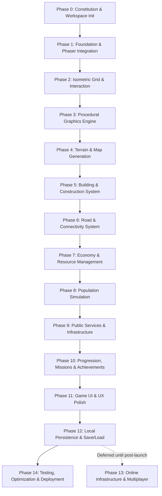

# Pixelopolis — Master Development Roadmap

> **Author:** Game Development Technical Lead & Software Architect  
> **Status:** Confirmed Baseline (Phase 0)  
> **Scope:** Complete 15-Phase Development Plan (Phase 0 through Phase 14)

---

## Roadmap Overview

Pixelopolis is built using a progressive, phase-gated engineering methodology. Each phase produces a self-contained, functional, and verifiable increment. Earlier phases establish rendering, math, and core infrastructure; middle phases introduce economic and social simulation systems; final phases focus on persistence, polish, and optimization.

---

## Detailed Phase Breakdown

---

### Phase 0 — Project Constitution and Workspace Initialization
- **Objective:** Establish the formal technical constitution, architectural standards, repository documentation, and long-term project guardrails before writing game code.
- **Scope:**
  - Create project directory `Pixelopolis`.
  - Author foundational governance files: `GEMINI.md`, `README.md`, `docs/ARCHITECTURE.md`, `docs/GAME_DESIGN.md`, `docs/DEVELOPMENT_ROADMAP.md`, `docs/DEVELOPMENT_LOG.md`, `docs/TECH_DECISIONS.md`.
  - Finalize all core technology choices and architectural principles.
- **Dependencies:** None.
- **Expected Deliverables:** Complete documentation suite; clean project directory ready for Phase 1.
- **Acceptance Criteria:**
  - All 7 core documentation files created and reviewed.
  - Zero application code, npm packages, or build artifacts present.
  - Development principles and coordinate standards documented.
- **Technical Risks:** Under-specifying architectural boundaries leading to coupling in subsequent phases.

---

### Phase 1 — Project Foundation and Phaser Integration
- **Objective:** Initialize the modern frontend workspace, configure strict TypeScript and Vite, mount Phaser 3 within React, and establish the decoupled communication bridge.
- **Scope:**
  - Initialize Vite with React and TypeScript (`strict: true`).
  - Install dependencies: `phaser`, `zustand`, `lucide-react`, and dev tools (`vitest`, `playwright`).
  - Implement canvas mounting lifecycle in React (`GameLayout.tsx`, `App.tsx`).
  - Build `GameEventBus` pub/sub communication bridge.
  - Configure `pixelArt: true`, `antialias: false`, and `roundPixels: true` in Phaser configuration.
- **Dependencies:** Phase 0.
- **Expected Deliverables:** Running Vite dev server, embedded responsive Phaser canvas, basic HUD overlay shell, typed event bus.
- **Acceptance Criteria:**
  - `npm run dev` launches with no errors or warnings.
  - Phaser canvas renders cleanly inside React layout without memory leaks on re-renders.
  - React can emit an event over `GameEventBus` and Phaser logs receipt.
  - TypeScript compiles with zero errors under strict mode.
- **Technical Risks:** React strict mode double-mounting causing duplicate Phaser canvas instances or WebGL context loss.

---

### Phase 2 — Isometric Grid and World Interaction
- **Objective:** Implement 2:1 isometric projection mathematics, camera pan/zoom controls, pointer picking, tile hover highlights, tile selection, and world boundary constraints.
- **Scope:**
  - Pure isometric conversion library (`gridToScreen`, `screenToGrid`, `pointerToGrid`, `getTileVertices`, `gridToIndex`, `indexToGrid`).
  - Camera system: drag-to-pan, mouse-wheel cursor-anchored zoom (0.5x to 2.0x), reset hotkey (`R`), drag-vs-click disambiguation (6px threshold).
  - Pointer coordinate picking accounting for camera scroll and zoom with green hover diamond highlight.
  - Persistent tile selection reticle (Cyan) with center pip and React Tile Inspector panel.
  - Algorithmic isometric grid line overlay toggleable via 'G' key and HUD button.
  - Configurable 20×20 grid boundary.
- **Dependencies:** Phase 1.
- **Expected Deliverables:** Interactive isometric grid where the player can pan, zoom, hover over tiles, click to select and inspect grid coordinates `(gx, gy)`, and toggle grid overlay.
- **Acceptance Criteria:**
  - Screen-to-grid raycasting accurately identifies the hovered tile under any camera zoom or pan position.
  - Unit tests verify `gridToScreen` and `screenToGrid` mathematical correctness and round-trip conversion.
  - Selection reticle persists reliably across pan, zoom, and window resizing.
  - Grid overlay toggles via HUD button and 'G' keyboard shortcut.
- **Status:** ✅ Complete.

---

### Phase 3 — Procedural Graphics Engine
- **Objective:** Build the programmatic pixel-art rendering pipeline to generate tiles, structures, and decorations entirely through code, with texture caching.
- **Scope:**
  - Procedural diamond tile drawing utilities with lighting (upper-left light source, lower-right shadows).
  - Seeded pseudo-random number generator (PRNG) for procedural texture variation.
  - Phaser `TextureManager` caching pipeline to generate textures once and reuse them by key.
  - Edge dithering, highlights, and shadow algorithms.
- **Dependencies:** Phase 2.
- **Expected Deliverables:** Modular procedural texture generator module (`src/game/graphics/`) capable of producing grass, dirt, water, and building tiles on demand.
- **Acceptance Criteria:**
  - Textures generate cleanly with pixel-art aesthetics (nearest-neighbor scaling, no blur).
  - `this.textures.exists(key)` prevents duplicate texture generation.
  - Frame rate remains at a solid 60 FPS without memory leaks.
- **Technical Risks:** Excessive canvas allocation during generation causing garbage collection pauses.

---

### Phase 4 — Terrain and Map Generation
- **Objective:** Generate a deterministic 20×20 isometric island map featuring diverse terrain types, elevation, and natural boundaries.
- **Scope:**
  - Seeded terrain generator producing grass, dirt, sand, and water tiles.
  - Auto-tiling transitions for shorelines and terrain borders.
  - Spatial grid data structure storing tile properties (type, elevation, buildable flag).
  - Map border aesthetics defining the edge of the playable world.
- **Dependencies:** Phase 3.
- **Expected Deliverables:** Deterministic 20×20 isometric landscape rendered on screen with distinct terrain biomes and shore transitions.
- **Acceptance Criteria:**
  - The same seed generates the exact same map layout every time.
  - Non-buildable tiles (e.g., deep water) are flagged appropriately in grid data.
  - Full depth sorting renders terrain layers in proper back-to-front order without visual glitches.
- **Technical Risks:** Complex corner auto-tiling logic producing edge-case visual artifacts.

---

### Phase 5 — Building and Construction System
- **Objective:** Implement data-driven building placement, multi-tile footprint validation, placement previews, and construction workflows.
- **Scope:**
  - Data-driven building catalog (`src/data/buildings/`) defining footprints (1×1, 2×2, 2×3), costs, and categories.
  - React construction menu with category tabs (Residential, Commercial, Industrial).
  - Interactive ghost placement preview in Phaser (green for valid, red for invalid).
  - Footprint validation: within map bounds, tiles are buildable, no overlapping structures.
  - Multi-tile depth sorting and building sprite anchoring.
  - Building demolition tool with resource refund logic.
- **Dependencies:** Phase 4.
- **Expected Deliverables:** Working construction system where players select buildings from React UI, preview placement on the grid, and build valid structures.
- **Acceptance Criteria:**
  - Buildings cannot be placed on occupied or invalid tiles.
  - Multi-tile buildings (e.g., 2×2) occupy all covered grid cells correctly.
  - Occlusion and depth sorting render buildings correctly in front of background tiles and behind foreground objects.
- **Technical Risks:** Depth sorting errors when tall buildings overlap adjacent tiles.

---

### Phase 6 — Road and Connectivity System
- **Objective:** Create a flexible road network system with auto-connecting isometric road tiles and network graph validation.
- **Scope:**
  - Data-driven road segment definitions.
  - Auto-connecting road tile logic (straight, corner, T-junction, 4-way crossroad).
  - Road network graph with adjacency mapping.
  - Building road connectivity validation (BFS/DFS check verifying connection to the city center).
  - Visual connectivity warning indicators (e.g., "no road access" icon over disconnected buildings).
- **Dependencies:** Phase 5.
- **Expected Deliverables:** Interactive road laying tool, dynamically connecting road textures, and real-time connectivity status updates for all placed buildings.
- **Acceptance Criteria:**
  - Road segments correctly update their visual connections as adjacent roads are added or removed.
  - Buildings recognize road adjacency accurately.
  - Disconnected buildings reflect inactive status in the domain layer.
- **Technical Risks:** Performance degradation during road graph traversal on larger networks.

---

### Phase 7 — Economy and Resource Management
- **Objective:** Implement the city treasury (coins), resource extraction cycles, industrial manufacturing chains, and resource storage limits.
- **Scope:**
  - Pure simulation tick loop for economic updates.
  - Primary currency (coins) accumulation via taxes and commercial revenue.
  - Raw material extraction (wood, stone) and processed goods (bricks, steel).
  - Timed production cycles on factories with player collection mechanics.
  - Inventory management, warehouse storage caps, and construction cost deductions.
  - React resource display and inventory drawer.
- **Dependencies:** Phase 6.
- **Expected Deliverables:** Functional economic engine where factories produce goods on timers, players collect products, and resources are consumed to construct advanced buildings.
- **Acceptance Criteria:**
  - Coins and materials deduct accurately upon construction.
  - Construction is blocked when resources or treasury funds are insufficient.
  - Production timers tick accurately and notify the player upon completion.
  - Pure domain unit tests verify 100% of economic math headlessly.
- **Technical Risks:** Timer drift or desynchronization when the browser tab is backgrounded.

---

### Phase 8 — Population Simulation
- **Objective:** Model residential housing occupancy, population growth curves, citizen satisfaction/happiness, and workforce distribution.
- **Scope:**
  - Residential building population capacity and occupancy progression.
  - Citizen happiness calculation based on service availability, road access, and pollution exposure.
  - Dynamic population migration: happiness increases occupancy; dissatisfaction causes abandonment.
  - Commercial revenue scaling directly tied to local customer population density.
- **Dependencies:** Phase 7.
- **Expected Deliverables:** Living population simulation reflecting citizen happiness levels, housing density, and economic prosperity across the city.
- **Acceptance Criteria:**
  - Residential buildings attract residents only when basic conditions are satisfied.
  - Industrial pollution creates a measurable happiness penalty on nearby residential tiles.
  - Total population updates in real time on the React HUD.
- **Technical Risks:** Balancing sensitivity where positive or negative feedback loops collapse the city economy too rapidly.

---

### Phase 9 — Public Services and Infrastructure
- **Objective:** Implement municipal services (power, water, waste) and emergency protections (fire, police, health) with radial coverage mechanics.
- **Scope:**
  - Utility distribution models: power plants and water towers providing capacity and coverage radii.
  - Public safety buildings: fire stations, police precincts, and clinics.
  - Coverage visualization overlays (colorized isometric radius display during placement).
  - Deficit penalties: unpowered or unprotected buildings suffer reduced productivity and happiness loss.
- **Dependencies:** Phase 8.
- **Expected Deliverables:** Service building placement with visible coverage rings, city-wide utility capacity gauges, and deficit alerts.
- **Acceptance Criteria:**
  - Coverage overlay dynamically visualizes covered vs. uncovered tiles during service placement.
  - Buildings outside coverage reflect appropriate visual warning badges and operational penalties.
  - Total utility capacity scales with utility buildings placed.
- **Technical Risks:** Performance overhead when recalculating overlapping radial coverage across large grids.

---

### Phase 10 — Progression, Missions and Achievements
- **Objective:** Build player progression systems including mayor levels, experience points (XP), milestone unlocks, guided missions, and achievements.
- **Scope:**
  - Mayor level and XP accumulation logic tied to building, upgrading, and producing.
  - Tiered building unlock tree gated by level and population milestones.
  - Objective tracker and mission system (tutorial missions, expansion goals).
  - Achievement badges with rewards (bonus coins, unique decorative landmarks).
  - React mission panel and achievement showcase.
- **Dependencies:** Phase 9.
- **Expected Deliverables:** Full progression loop with leveling animations, guided starter quests, unlock notifications, and achievement tracking.
- **Acceptance Criteria:**
  - Locked buildings cannot be built before meeting level/population requirements.
  - Completing mission criteria triggers visual notifications and awards correct payouts.
  - Progression state is cleanly serializable.
- **Technical Risks:** Quest condition checking becoming tangled with simulation logic without a clean event listener architecture.

---

### Phase 11 — Game UI and UX Polish
- **Objective:** Elevate visual quality, player feedback, audio cues, responsive design, and interface ergonomics across all screen sizes.
- **Scope:**
  - High-fidelity React HUD theme with pixel-art borders, custom typography, and micro-interactions.
  - Contextual building inspector panel (demolish, upgrade, stats, service status).
  - Synthesized sound effects (Web Audio API / Phaser Sound) for clicks, construction, errors, and ambient city buzz.
  - Keyboard shortcuts (Escape to cancel, numbers to select tools, WASD/arrows to pan).
  - Animated notification toasts for level-ups, production completions, and warnings.
- **Dependencies:** Phase 10.
- **Expected Deliverables:** Polished, responsive, and tactile interface with audio feedback and intuitive inspection controls.
- **Acceptance Criteria:**
  - All interactive elements produce distinct audio/visual feedback.
  - UI scales cleanly across standard desktop browser viewports (1280×720 to 4K).
  - Zero input blocking between React dialogs and Phaser canvas.
- **Technical Risks:** Audio autoplay policy restrictions in modern browsers requiring deferred audio context initialization.

---

### Phase 12 — Local Persistence and Save/Load
- **Objective:** Implement comprehensive client-side persistence with IndexedDB, multi-slot save management, auto-save, and schema migration support.
- **Scope:**
  - IndexedDB storage engine wrapper (`src/persistence/`).
  - Serialization pipeline transforming domain state and grid into compact, versioned JSON.
  - Multiple save slots (Slot 1, Slot 2, Slot 3, AutoSave).
  - Periodic auto-save and save-on-window-unload handlers.
  - Schema migration runner (`migrations/`) to safely upgrade earlier save versions.
  - Manual Save / Load / Reset modal in React settings.
- **Dependencies:** Phase 11.
- **Expected Deliverables:** Reliable save and load system allowing players to close their browser, return, and resume their city seamlessly.
- **Acceptance Criteria:**
  - Reloading the page restores the complete city state (tiles, buildings, timers, inventory, XP) with 100% fidelity.
  - Corrupt save data is caught gracefully with error recovery instead of crashing.
  - Multi-slot save/load operations succeed without data leakage across slots.
- **Technical Risks:** Unversioned schema changes breaking backwards compatibility with earlier player saves.

---

### Phase 13 — Online Infrastructure and Multiplayer *(STRICTLY DEFERRED)*
- **Objective:** Evaluate and integrate cloud backend capabilities for cross-device cloud saves, asynchronous player city visits, and regional trading.
- **Scope:**
  - Backend integration via Supabase (PostgreSQL, Auth, Realtime).
  - Cloud save synchronization alongside local IndexedDB.
  - Mayor leaderboards (population, city value, happiness).
  - Asynchronous city visiting (read-only spectator mode of friend cities).
  - Cross-player commodity trade depot.
- **Dependencies:** Complete, battle-tested single-player experience (Phase 12).
- **Expected Deliverables:** Cloud authentication, multi-device save sync, and social city viewing features.
- **Acceptance Criteria:**
  - Fully offline gameplay remains 100% functional when disconnected.
  - Cloud synchronization resolves conflicts deterministically.
- **Technical Risks:** Complex conflict resolution between offline local edits and remote cloud state.
- **DEFERRED NOTICE:** *This phase is strictly postponed until the single-player game is fully launched, optimized, and stabilized.*

---

### Phase 14 — Testing, Optimization and Deployment
- **Objective:** Perform comprehensive performance optimization, complete automated test suites (Vitest + Playwright), and establish production deployment pipelines.
- **Scope:**
  - Rendering performance profiling: sprite batching, offscreen culling, memory leak audits.
  - Automated test coverage: 90%+ unit test coverage on domain logic with Vitest.
  - Playwright E2E test suite covering critical user journeys (new game, build road, place house, level up, save, reload).
  - Production Vite build optimization, asset compression, and bundle size reduction (<1.5MB initial payload target).
  - Deployment configuration (static web hosting on Vercel/Netlify/GitHub Pages).
- **Dependencies:** Phase 12.
- **Expected Deliverables:** High-performance, production-ready build with automated CI testing passing reliably.
- **Acceptance Criteria:**
  - Solid 60 FPS performance maintained with 200+ active on-screen sprites.
  - All unit, integration, and E2E tests pass cleanly in automated CI runs.
  - Production build produces zero bundling warnings and validates on Chrome, Firefox, Safari, and Edge.
- **Technical Risks:** Browser-specific WebGL quirks or memory leaks under sustained playtime.

---

## Roadmap Summary & Progression Tracking

| Phase | Milestone Name | Dependencies | Status |
| :---: | :--- | :--- | :---: |
| **0** | Project Constitution and Workspace Initialization | None | ✅ **Complete** |
| **1** | Project Foundation and Phaser Integration | Phase 0 | ⬜ Planned |
| **2** | Isometric Grid and World Interaction | Phase 1 | ⬜ Planned |
| **3** | Procedural Graphics Engine | Phase 2 | ⬜ Planned |
| **4** | Terrain and Map Generation | Phase 3 | ⬜ Planned |
| **5** | Building and Construction System | Phase 4 | ⬜ Planned |
| **6** | Road and Connectivity System | Phase 5 | ⬜ Planned |
| **7** | Economy and Resource Management | Phase 6 | ⬜ Planned |
| **8** | Population Simulation | Phase 7 | ⬜ Planned |
| **9** | Public Services and Infrastructure | Phase 8 | ⬜ Planned |
| **10** | Progression, Missions and Achievements | Phase 9 | ⬜ Planned |
| **11** | Game UI and UX Polish | Phase 10 | ⬜ Planned |
| **12** | Local Persistence and Save/Load | Phase 11 | ⬜ Planned |
| **13** | Online Infrastructure and Multiplayer | Phase 12 | ⏳ **Deferred** |
| **14** | Testing, Optimization and Deployment | Phase 12 | ⬜ Planned |
