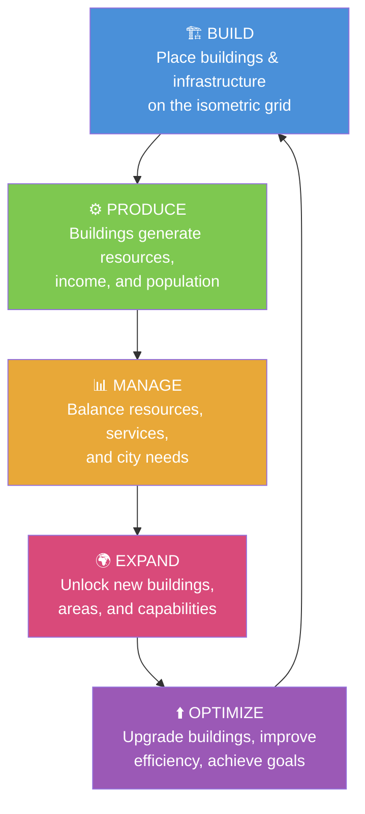
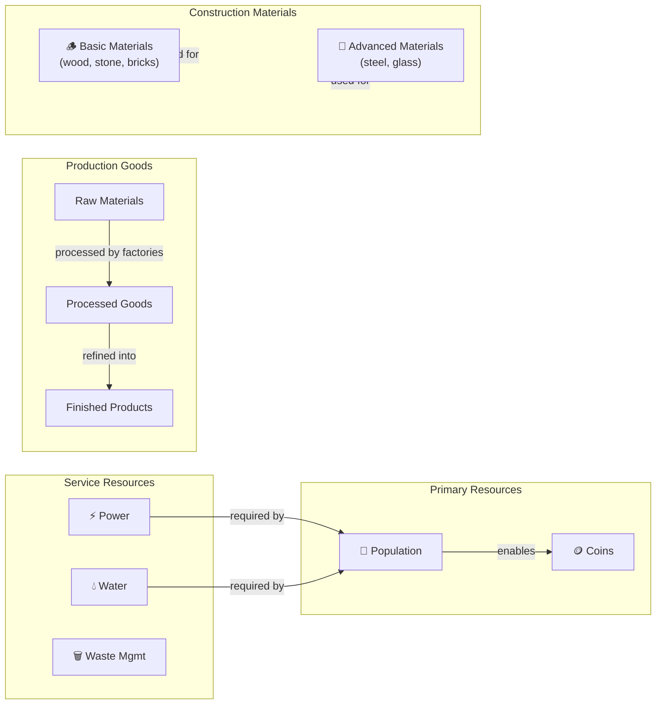
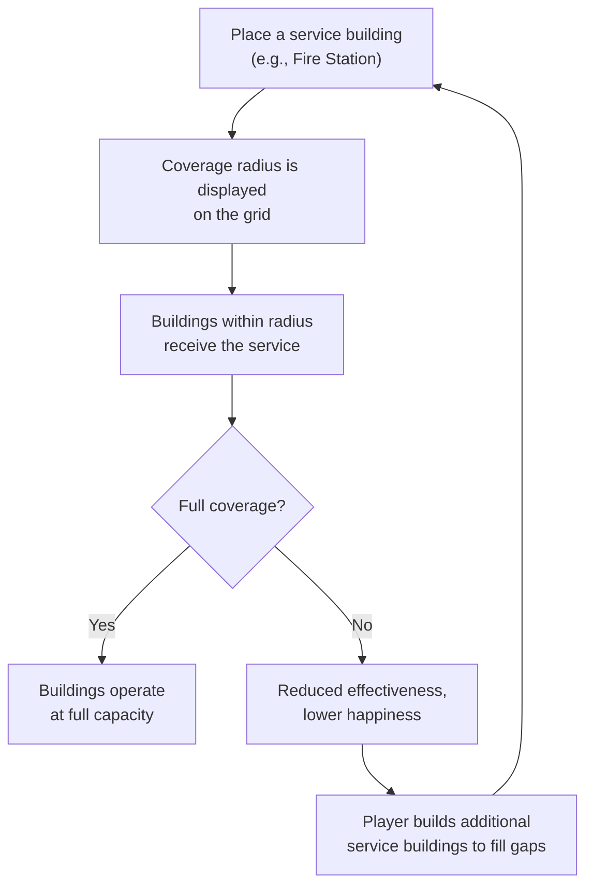
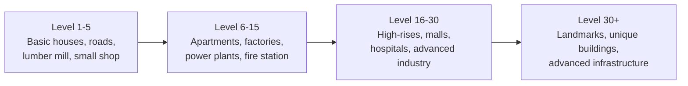

# Pixelopolis — Game Design Document

> **Project:** Pixelopolis  
> **Genre:** Isometric Pixel-Art City-Building Simulation  
> **Platform:** Browser-Based (Web)  
> **Status:** In Development

---

## Table of Contents

1. [Game Vision](#1-game-vision)
2. [Core Gameplay Loop](#2-core-gameplay-loop)
3. [Building Categories](#3-building-categories)
4. [Resource Categories](#4-resource-categories)
5. [City Development Mechanics](#5-city-development-mechanics)
6. [Population Mechanics](#6-population-mechanics)
7. [Progression Concepts](#7-progression-concepts)
8. [Missions and Achievements](#8-missions-and-achievements)
9. [User Interface Concepts](#9-user-interface-concepts)
10. [Future Gameplay Possibilities](#10-future-gameplay-possibilities)

---

## 1. Game Vision

Pixelopolis is a browser-based city-building simulation where players construct and manage a thriving isometric pixel-art city from the ground up. Starting with an empty plot of land and a handful of resources, the player takes on the role of mayor — laying roads, zoning neighborhoods, balancing budgets, and guiding a small settlement toward becoming a bustling metropolis.

The game emphasizes the following pillars:

| Pillar | Description |
|---|---|
| **Strategic Resource Management** | Players must carefully balance income, materials, population, and services to sustain growth. Expansion without planning leads to shortages and citizen unhappiness. |
| **Progressive City Development** | The city evolves visually and functionally over time. New building types, larger structures, and expanded map areas unlock as the player reaches milestones. |
| **Visual Satisfaction** | The isometric pixel-art aesthetic rewards players with a tangible sense of progress — watching a barren grid transform into a vibrant, animated cityscape. |
| **Balanced Economic Systems** | Production chains, supply and demand, and service coverage create interlocking systems that reward thoughtful planning over brute-force expansion. |
| **Achievement-Driven Progression** | Missions, achievements, and city-quality ratings give players clear goals and a sense of accomplishment at every stage of development. |

Pixelopolis draws inspiration from the broader city-building genre and the resource-management experience found in games like SimCity BuildIt, but establishes its own identity through its charming pixel-art visual style, its browser-first accessibility, and its focus on satisfying, medium-complexity economic loops that are deep enough to engage but approachable enough for casual sessions.

---

## 2. Core Gameplay Loop

The primary gameplay experience in Pixelopolis revolves around a five-phase cycle. Each phase feeds into the next, creating a continuous loop of growth and optimization.



### Phase Descriptions

1. **Build** — The player places buildings and infrastructure on the isometric grid. Every structure requires an open grid space, certain resources to construct, and (in most cases) road connectivity. Placement is deliberate: proximity to services matters, and zoning decisions have lasting consequences.

2. **Produce** — Once placed, buildings begin to function. Residential buildings attract citizens. Commercial buildings generate coins from the surrounding population. Industrial buildings produce materials and goods. Infrastructure supplies power, water, and other essential services. Production happens over time, with collection intervals that vary by building type.

3. **Manage** — As the city grows, competing demands emerge. Citizens need services, buildings need resources, and expansion requires materials. The player must monitor supply and demand, ensure service coverage, and resolve bottlenecks before they cascade into larger problems such as declining happiness or stalled growth.

4. **Expand** — Reaching population milestones, accumulating resources, and leveling up unlocks new possibilities. New building types become available, new map areas can be purchased, and more advanced production chains open up. Expansion is the reward for successful management.

5. **Optimize** — With new tools and a growing city, the player revisits earlier decisions. Buildings can be upgraded for improved output or reduced footprint. Road networks can be restructured. Production chains can be streamlined. Achievements and star ratings incentivize the player to push for higher efficiency, which in turn enables the next round of ambitious building.

The loop then repeats at a higher level of complexity and scale.

---

## 3. Building Categories

Buildings are the fundamental units of gameplay. Every building occupies space on the isometric grid, requires resources to construct, and contributes to (or draws from) one or more city systems. Buildings are organized into six major categories.

> [!NOTE]
> Specific construction costs, production rates, and population values are subject to balancing and are not specified here. The descriptions below define each category's **role and behavior** within the game's systems.

---

### 3.1 Residential

Residential buildings provide the city's population — the citizens who live, work, and consume within the city.

| Tier | Examples | Concept |
|---|---|---|
| **Basic** | Small houses, cottages | Low population yield; minimal service requirements; quick to build. Suitable for early game. |
| **Mid-tier** | Apartments, townhouses | Moderate population yield; require power and water services. |
| **High-tier** | High-rises, luxury condos | High population yield; require full service coverage (power, water, fire, police, health). Visual showpieces. |

**Key behaviors:**
- Provide population to the city.
- Require infrastructure services (water, power) to function at full capacity. Without required services, population yield is reduced or the building becomes inactive.
- Can be upgraded through tiers, improving population capacity and visual appearance.
- Happiness level of residents is influenced by nearby services, pollution, and public amenities.

---

### 3.2 Commercial

Commercial buildings represent the city's economic engine — shops and businesses that generate coin income by serving the population.

| Tier | Examples | Concept |
|---|---|---|
| **Basic** | Corner shops, food stalls | Small income; low population threshold to operate. |
| **Mid-tier** | Markets, retail stores | Moderate income; require a certain population density nearby. |
| **High-tier** | Shopping malls, department stores | High income; require large population and full services. |

**Key behaviors:**
- Generate coins over time, scaled by the available population within their service area.
- Require road connectivity to function — a commercial building without a road connection produces nothing.
- Higher-tier commercial buildings require higher surrounding population density to unlock their full earning potential.
- May consume certain production goods (e.g., a bakery consumes flour) in advanced gameplay loops.

---

### 3.3 Industrial

Industrial buildings produce the materials and goods that fuel city construction and economic growth.

| Tier | Examples | Concept |
|---|---|---|
| **Basic** | Lumber mills, quarries | Produce basic raw materials (wood, stone). |
| **Mid-tier** | Factories, workshops | Process raw materials into construction materials (bricks, steel). |
| **High-tier** | Advanced manufacturing, refineries | Produce finished goods and advanced materials (glass, electronics). |

**Key behaviors:**
- Produce materials and goods on timed production cycles. The player initiates production and collects the output when it is ready.
- Essential for construction supply chains — most buildings beyond the earliest tier require industrial output to build.
- May cause pollution in surrounding tiles, reducing happiness of nearby residential buildings. This creates a zoning tension: industry is necessary but should be placed thoughtfully.
- Can be upgraded to improve production speed or output quantity.
- Support supply chains: raw materials → processed goods → finished products.

---

### 3.4 Infrastructure

Infrastructure buildings provide the essential services and connectivity that all other buildings depend on.

| Type | Examples | Concept |
|---|---|---|
| **Connectivity** | Roads, bridges, intersections | Connect buildings to the road network. Required for commercial and many other building types to function. |
| **Power** | Power plants, solar farms, wind turbines | Supply electrical power within a coverage radius. Buildings outside power coverage operate at reduced capacity or not at all. |
| **Water** | Water towers, pumping stations | Supply water within a coverage radius. Required by residential and many other buildings. |
| **Waste** | Landfills, recycling centers | Handle waste generated by the city. Insufficient waste management reduces happiness. |

**Key behaviors:**
- Roads are the connective tissue of the city. Most non-infrastructure buildings require an adjacent road connection.
- Utility buildings (power, water, waste) have a coverage area — a radius within which they provide their service. Planning coverage efficiently is a core strategic challenge.
- Infrastructure buildings have maintenance costs (ongoing coin drain) but provide no direct income. They are pure enablers.
- Upgrading infrastructure increases coverage area or capacity.

---

### 3.5 Public Services

Public service buildings provide safety, health, education, and civic functions that improve citizen well-being and unlock city growth.

| Type | Examples | Concept |
|---|---|---|
| **Safety** | Fire stations, police stations | Reduce disaster risk and crime within a coverage area. Required for mid-to-high-tier residential upgrades. |
| **Health** | Clinics, hospitals | Improve citizen health and happiness within a coverage area. |
| **Education** | Schools, libraries, universities | Improve citizen skill level, unlocking advanced building types and boosting commercial output. |
| **Civic** | Town hall, city hall | Administrative buildings that may provide city-wide bonuses or serve as upgrade prerequisites. |

**Key behaviors:**
- Each public service building covers a radius around it. Buildings within that radius receive the service benefit.
- Coverage gaps (e.g., an area without fire protection) create risk or reduce the potential of buildings in that area.
- Public services are often prerequisites for upgrading residential buildings to higher tiers.
- Higher-tier public service buildings cover larger areas or provide stronger effects.

---

### 3.6 Special / Landmarks

Special buildings and landmarks are unique structures that provide aesthetic, happiness, or prestige bonuses. They reward player achievement and add character to the city.

| Type | Examples | Concept |
|---|---|---|
| **Parks & Recreation** | Small parks, fountains, sports fields | Boost happiness for nearby residential buildings. Relatively inexpensive; used to offset pollution or service gaps. |
| **Monuments** | Statues, clock towers, arches | Prestige structures that provide city-wide or area-based bonuses. Often unlocked through achievements. |
| **Unique Buildings** | Landmarks specific to progression milestones | One-of-a-kind structures that serve as trophies and provide significant bonuses. Cannot be duplicated. |

**Key behaviors:**
- Primarily provide happiness bonuses and aesthetic value.
- Some landmarks grant unique gameplay effects (e.g., a small boost to all commercial income city-wide).
- Unlocked through achievements, milestones, or special events rather than being freely purchasable.
- Serve as visual anchors and points of pride within the city layout.

---

## 4. Resource Categories

The city's economy runs on four interconnected resource categories. Understanding and managing their flows is the heart of Pixelopolis gameplay.



### 4.1 Primary Resources

| Resource | Source | Role |
|---|---|---|
| **Coins** | Taxes on population, commercial building income, selling goods | The main currency used for constructing buildings, purchasing upgrades, expanding map areas, and maintaining infrastructure. |
| **Population** | Residential buildings | Citizens who live in the city. Population is both a resource (enabling commercial income and unlocking milestones) and a metric of city success. |

Coins and population form the fundamental feedback loop: population generates coins, and coins fund the buildings that attract more population.

### 4.2 Construction Materials

Construction materials are consumed when placing or upgrading buildings. They do not regenerate passively — the player must produce or acquire them.

- **Basic Materials** (e.g., wood, stone, bricks) — Produced by early-game industrial buildings. Used for constructing basic and mid-tier structures.
- **Advanced Materials** (e.g., steel, glass) — Produced by higher-tier industrial buildings, often requiring basic materials as inputs. Used for constructing advanced structures and performing high-tier upgrades.

### 4.3 Production Goods

Production goods represent the output of the city's industrial sector. They follow a supply-chain model:

1. **Raw Materials** — Harvested or extracted by basic industry (e.g., lumber from a lumber mill, ore from a mine).
2. **Processed Goods** — Created by mid-tier factories that consume raw materials (e.g., planks from lumber, ingots from ore).
3. **Finished Products** — Produced by advanced manufacturing that consumes processed goods (e.g., furniture from planks, tools from ingots).

Finished products can be sold for coins, used for building upgrades, or consumed by advanced commercial buildings. The supply-chain model rewards planning and creates meaningful choices about what to produce.

### 4.4 Service Resources

Service resources are not stockpiled — they represent ongoing capacity provided by infrastructure buildings.

| Service | Provider | Consumer |
|---|---|---|
| **Power** | Power plants, solar farms, wind turbines | Nearly all non-road buildings |
| **Water** | Water towers, pumping stations | Residential, commercial, and public service buildings |
| **Waste Management** | Landfills, recycling centers | Generated by population; must be handled to maintain happiness |

The player must ensure that total service capacity meets or exceeds total demand. Service shortfalls reduce building effectiveness and citizen happiness.

---

## 5. City Development Mechanics

### 5.1 Grid-Based Placement

The city is built on an isometric grid. Each building occupies one or more grid cells. The player selects a building from the toolbar, previews its footprint on the grid, and places it in a valid location.

**Placement rules:**
- The target cells must be empty (no existing building or obstacle).
- Most buildings require an adjacent road connection.
- Some buildings have additional placement constraints (e.g., water pumps near water sources, power plants away from residential zones).
- Buildings cannot overlap.

### 5.2 Road Connectivity

Roads form the backbone of city connectivity. A building is considered "connected" if it is adjacent to a road tile that is part of the main road network (i.e., ultimately connects back to a city origin point or town hall).

- Disconnected buildings lose functionality (commercial buildings stop generating income; residential buildings may lose population).
- Road placement is free or low-cost to encourage network building, but roads consume grid space that could otherwise be used for buildings.
- Intersections, curves, and bridges provide routing flexibility.

### 5.3 Service Coverage Areas

Utility and public service buildings project a coverage area — typically a radius measured in grid tiles around the building.



Efficient coverage planning — minimizing the number of service buildings needed to cover the entire city — is a key strategic challenge.

### 5.4 Zoning Concepts

While Pixelopolis does not enforce formal zoning districts, the interplay of pollution, service coverage, and proximity bonuses creates emergent zoning behavior:

- **Residential areas** benefit from proximity to public services, parks, and commercial buildings, and suffer from proximity to industry (pollution).
- **Commercial areas** benefit from high population density nearby and road connectivity.
- **Industrial areas** produce pollution and are best placed at the city periphery, away from residential zones but still connected by roads.

Players naturally develop distinct city districts through these incentives.

### 5.5 Map Expansion

The city starts on a limited map area. Additional land tiles can be unlocked by:

- Reaching population milestones.
- Spending coins and/or materials.
- Completing specific missions.

Newly unlocked areas may contain different terrain features (rivers, hills, forests) that present new building challenges and opportunities.

### 5.6 Building Upgrades

Most buildings support one or more upgrade levels. Upgrading a building:

- Improves its output (more population, more income, faster production).
- Changes its visual appearance (taller, more detailed, more animated).
- May increase its service requirements.
- Costs construction materials and/or coins.

Upgrades are a core part of the optimization phase — improving existing infrastructure is often more efficient than building new.

### 5.7 Population Milestones

The city's total population serves as the primary progression gate. Reaching specific population thresholds unlocks:

- New building types.
- New map expansion opportunities.
- New upgrade tiers.
- Story or tutorial progression.

> [!IMPORTANT]
> Specific population milestone values are subject to balancing and are not defined in this document. The milestone system should be tuned so that each new unlock feels earned but not grindy.

---

## 6. Population Mechanics

Population is the lifeblood of Pixelopolis. It functions as both a resource and a primary success metric.

### 6.1 Population Sources

Population is provided exclusively by residential buildings. Each residential building contributes a base population value, modified by:

- The building's upgrade level.
- Whether required services (power, water) are available.
- The happiness level of the building's residents.

### 6.2 Happiness

Citizen happiness is calculated per residential building (or per zone) based on surrounding conditions:

| Factor | Effect on Happiness |
|---|---|
| Service coverage (power, water, waste) | Positive — meeting basic needs |
| Public services (fire, police, health, education) | Positive — safety and well-being |
| Parks and landmarks nearby | Positive — quality of life |
| Commercial buildings nearby | Slight positive — convenience |
| Pollution from industry | Negative |
| Overcrowding or service shortfalls | Negative |

Happiness affects:
- **Population yield** — Unhappy residential buildings may lose residents over time.
- **Commercial income** — Happy citizens spend more.
- **City rating** — Overall happiness contributes to the city's star rating.

### 6.3 Population as an Enabler

Population drives the rest of the city's economy:

- **Commercial income** scales with available population. More citizens means more customers.
- **Population milestones** unlock new content and progression.
- **Demand signals** — the population generates demand for services, goods, and amenities, guiding the player on what to build next.

### 6.4 Demand System

Citizens express needs through a demand system. When demand for a particular service or building type is high, the game signals the player (via UI indicators) that action is needed. For example:

- High housing demand → Citizens want more residential buildings.
- High commercial demand → The population can support more shops.
- Service demand → Citizens need fire protection, water, etc.

The demand system acts as a soft tutorial, gently guiding the player toward balanced development without rigidly enforcing a build order.

---

## 7. Progression Concepts

Progression in Pixelopolis operates on multiple parallel tracks that reinforce each other.

### 7.1 City Level / Mayor Level

The player has a **city level** (also referred to as mayor level) that increases as they earn experience points (XP). XP is awarded for:

- Constructing buildings.
- Completing upgrades.
- Fulfilling missions.
- Reaching achievements.
- Collecting resources.

Each level-up may unlock new building types, new features, or new mission chains.

### 7.2 Building Unlocks

New building types are gated behind either city level or population milestones (or both). Early game offers a small selection of basic buildings; the available catalog grows steadily as the player progresses.



> [!NOTE]
> Level ranges shown above are conceptual and illustrative. Actual level thresholds will be determined during balancing.

### 7.3 Missions and Quests

Missions provide structured goals that guide the player through the game's systems. See [Section 8](#8-missions-and-achievements) for details.

### 7.4 Star Ratings

The city receives an overall quality rating (e.g., one to five stars) based on aggregate metrics:

- Population size
- Citizen happiness
- Service coverage completeness
- City aesthetics (parks, landmarks)
- Economic health

Star ratings serve as a high-level goal for experienced players and provide a sense of comparative quality.

---

## 8. Missions and Achievements

### 8.1 Mission Types

| Type | Purpose | Examples |
|---|---|---|
| **Tutorial Missions** | Teach core mechanics to new players | "Build your first road," "Place a house," "Connect to power" |
| **Progression Missions** | Guide the player through development stages | "Reach a population of [milestone]," "Build your first factory," "Upgrade a house to tier 2" |
| **Challenge Missions** | Provide optional, harder goals for engaged players | "Achieve full service coverage," "Maintain high happiness for a sustained period" |

Missions are presented through a mission panel in the UI. Active missions display their objectives and progress. Completed missions award rewards and may unlock the next mission in a chain.

### 8.2 Achievement System

Achievements are milestone-based badges awarded for cumulative accomplishments. Unlike missions, achievements are not sequential — the player earns them organically as they play.

**Achievement categories include:**

- **Building milestones** — First building of each type, total buildings placed.
- **Population milestones** — Reaching population thresholds.
- **Economic milestones** — Total coins earned, goods produced.
- **Service milestones** — Full coverage of a service type, all services active.
- **Aesthetic milestones** — Number of parks placed, landmarks built.
- **Mastery milestones** — Reaching maximum upgrade level, achieving five-star rating.

### 8.3 Rewards

Completing missions and earning achievements grants rewards such as:

- Coins
- Construction materials
- XP
- Exclusive decorative buildings or landmarks
- Unlock of new building types (in some cases)

> [!TIP]
> The reward system should be tuned so that mission rewards feel meaningful — enough to noticeably accelerate the player's next goal — without trivializing the resource management challenge.

---

## 9. User Interface Concepts

The UI is designed for clarity and efficiency within a browser viewport. It must be usable on both desktop (mouse/keyboard) and tablet (touch) inputs.

### 9.1 Layout Overview

```
┌──────────────────────────────────────────────────────┐
│  [Coins] [Pop] [Materials]    [City Lvl] [⚙ Settings]│  ← Top HUD
├──────────────────────────────────────────────────────┤
│                                          ┌─────────┐ │
│                                          │ Details │ │
│           Isometric City View            │  Panel  │ │  ← Main View
│              (scrollable,                │         │ │
│               zoomable)                  │(context)│ │
│                                          └─────────┘ │
│  ┌──────┐                                            │
│  │Mini- │                                            │
│  │ map  │                                            │
│  └──────┘                                            │
├──────────────────────────────────────────────────────┤
│ [🏠 Res] [🏪 Com] [🏭 Ind] [🛣️ Infra] [🏛️ Svc] [⭐ Spc] │  ← Bottom Toolbar
└──────────────────────────────────────────────────────┘
```

### 9.2 Component Descriptions

| Component | Description |
|---|---|
| **Top HUD** | Persistent bar displaying key resources (coins, population, material counts), current city level, and access to settings/menus. Updates in real time. |
| **Main Isometric View** | The central game area. Displays the city on the isometric grid. Supports scrolling (pan), zooming, and building selection via click/tap. |
| **Bottom Toolbar** | Category tabs for building placement. Selecting a category reveals a scrollable row of available buildings within that category. Each building shows its icon, name, and basic cost. |
| **Details / Side Panel** | Context-sensitive panel that appears when a building is selected. Shows building name, stats, production status, upgrade options, and demolish button. |
| **Mini-map** | A small overview map in the corner showing the entire city at a glance. The current viewport is highlighted. Clicking the mini-map pans the main view. |
| **Notifications** | Toast-style popups that inform the player of completed productions, mission progress, level-ups, and issues (e.g., "Power shortage in sector 3"). |
| **Settings / Save Menu** | Accessible from the top HUD. Contains audio settings, graphics quality options, save/load functionality, and help/tutorial access. |

### 9.3 Interaction Model

- **Build mode:** Player selects a building from the toolbar → building footprint follows the cursor on the grid → player clicks to confirm placement (or taps on mobile).
- **Select mode:** Player clicks on an existing building → details panel opens with that building's info, stats, and available actions.
- **Pan and zoom:** Mouse drag or touch drag to pan. Scroll wheel or pinch to zoom.

---

## 10. Future Gameplay Possibilities

> [!WARNING]
> The features listed in this section are **speculative ideas only**. They are not committed to, not scheduled, and not guaranteed to appear in any version of Pixelopolis. They are recorded here as creative directions that could be explored if the core game warrants expansion.

### Potential Future Features

| Idea | Description |
|---|---|
| **Disasters** | Random or triggered events (fires, storms, earthquakes) that damage buildings and test the player's preparedness. Fire stations and other services would mitigate damage. |
| **Seasons / Day-Night Cycle** | Visual and gameplay variations tied to time. Seasons could affect production rates; a day-night cycle could add visual atmosphere and shift building behavior. |
| **Trading Between Cities** | A market system where players can buy and sell surplus materials, creating an economy beyond the single-city scope. |
| **Multiplayer / Visiting Other Cities** | Social features allowing players to visit friends' cities, compare progress, or cooperate on shared goals. |
| **Special Events** | Time-limited events with exclusive buildings, missions, and rewards. Provides recurring engagement for long-term players. |
| **Economy Simulation Depth** | More granular economic modeling — supply/demand pricing, market fluctuations, citizen income brackets, property values. |
| **Tourism** | Attracting virtual tourists based on city appeal, generating a secondary income stream. Landmarks and aesthetics would drive tourist volume. |
| **Education System** | A deeper education mechanic where citizen skill levels affect industrial productivity, commercial income, and unlock conditions. |
| **Transportation Networks** | Bus lines, train systems, and highways that affect connectivity, commute times, and citizen satisfaction beyond simple road adjacency. |

These ideas would be evaluated based on player feedback, technical feasibility, and alignment with the core game vision before any development commitment is made.

---

*This document defines the design direction for Pixelopolis. It is a living document and will be updated as design decisions are finalized and balancing is completed.*
